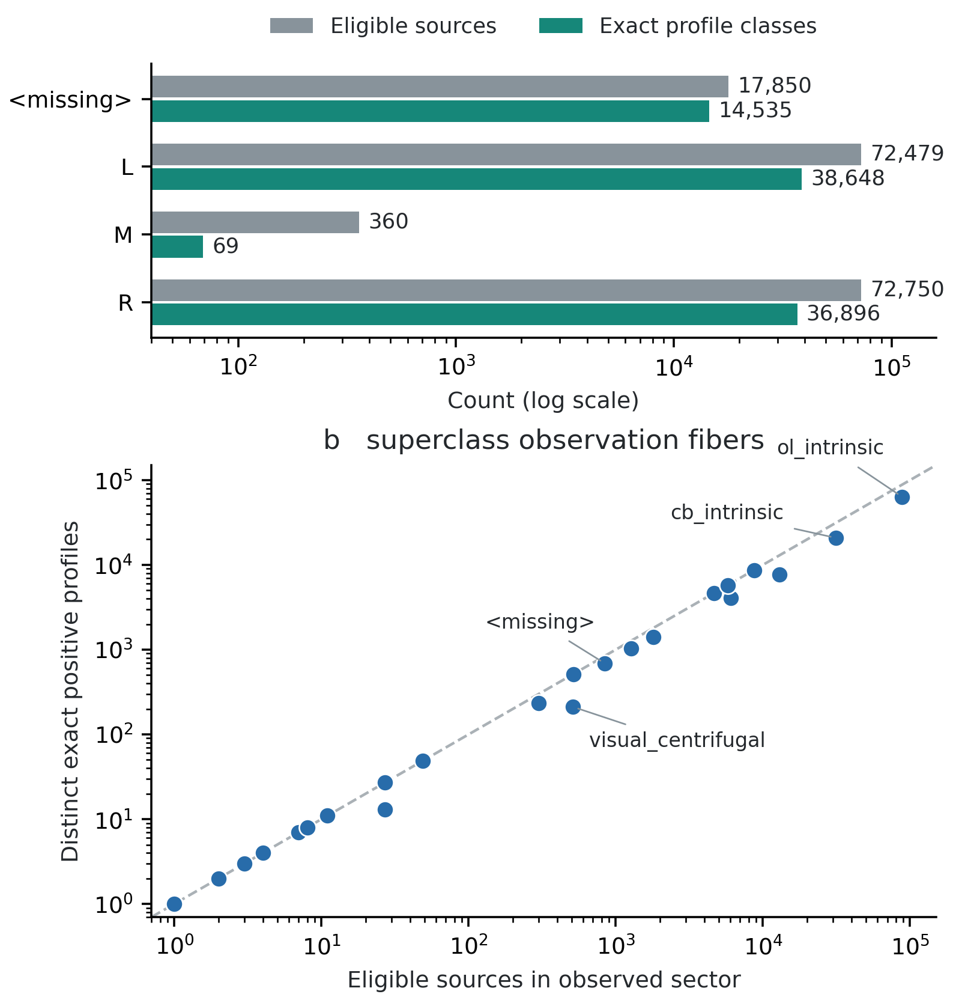
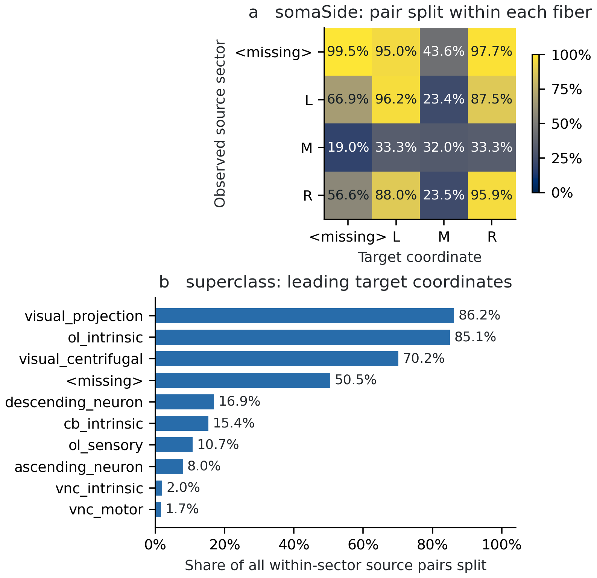

# A Path Is Not a State
### Exact Predictive Refinement of Fixed Connectome Partitions

**WuJun Chen**

Independent Researcher

ORCID: 0009-0007-9561-2892

## Abstract

We ask whether a fixed externally supplied network partition supports
exact one-step prediction for a signed nonlinear network model. For
finite signed matrices with absolute outgoing-row normalization and
unit-gain clipping, sector-mean dynamics factor on eligible unit states
if and only if normalized positive outgoing sector profiles are constant
within each source sector. These profiles give the coarsest refinement
of the fixed partition that determines its original observation's
one-step successor on that domain. Applied to 163,439 eligible MaleCNS
sources, the four somaSide observation fibers split into 90,148 exact
predictive classes; the largest fiber contains 36,896 classes among
72,750 sources. A unique set of three of the four target coordinates
separates all classes, although the omitted coordinate certifies an
individual failure. The criterion specializes classical block-row-sum
logic rather than establishing closure on mixtures or later states.
Previously published structural and reached-set audits provide two
contrasting tests: complete depth-two and depth-three route lifting
coexists with one-step nonfactorization, while a one-step factor on a
separate 711-source rational domain lacks a verified image endomap.

**Keywords:** connectome; coarse-graining; predictive refinement; routed
composition; dynamic closure; lumpability.

## 1. Introduction

A fixed annotation partition gives an economical network description,
but may identify sources with different observed one-step successors.
We ask how many predictive distinctions remain unresolved inside its
observation fibers, and characterize the coarsest refinement that
retains them on eligible unit inputs.

A network summary can also preserve an edge without preserving a path,
and preserve a path without preserving a state. Relay compatibility,
same-observation successor equality, and successor-image closure are
different requirements even when they use the same carrier.

This paper studies them in a model built from the MaleCNS v1.0 connectome
\cite{berg2026malecns,maleCNSdownload}. The connectome supplies detected
connections and annotations; the signed operator, normalization, clipped
update, and observation functions are declared modeling choices.

The primary question is:

> For a fixed network partition, what is the coarsest refinement of
> eligible unit sources that determines its observed one-step successor?

For the specified signed, normalized, clipped update, positive outgoing
sector profiles answer that question exactly. We count their classes in
the fixed somaSide and superclass partitions of the retained carrier.
The count measures one-step predictions merged by the annotations on
eligible unit inputs.

The general characterization makes the descriptive census possible
without fitting trajectories. The somaSide annotation merges 163,439
eligible unit sources into four current-observation fibers, but exact
profile equality divides them into 90,148 classes of distinct observed
one-step successors. This does not merely scale with source-sector
size: the slightly larger R fiber has fewer predictive classes than L,
while even the 360-source M fiber contains 69. A single exact failure
pair is separated by target coordinate M, yet the unique smallest
coordinate set that separates *all* somaSide classes is
$\{\texttt{<missing>},L,R\}$. The coordinate needed for one local
witness is therefore not necessarily needed for the complete finite
predictive refinement.

The supporting comparisons test different operations. On the same
carrier, all somaSide routes at depths two and three lift, yet the
observed one-step update fails to factor. A separate reached-set study
tests whether an exact one-step factor can be iterated. These contrasts
locate the predictive-refinement result between routed composition and
coarse-state dynamics.

### 1.1. Relation to the earlier preprints

The structural and reached-set analyses were previously reported in
Papers XVI and XVII \cite{paper16,paper17}. New to this manuscript are
the unit-source predictive-refinement characterization, the exact
full-domain somaSide and coordinate-resolved census, and a compact
rational certificate for a previously identified failure. The earlier
results remain separate tests of structural composition and iterative
closure. The superclass profile total reproduces Paper XVI's earlier
exact grouping result.

### 1.2. Related work and contribution

Classical lumpability concerns when a projected Markov process retains
a closed law \cite{kemenySnell1976}; higher-order lumpability studies the
effect of retaining observation history \cite{geigerTemmel2014}. Faccin,
Schaub, and Delvenne use entrograms to characterize information flow and
memory under network coarse-graining \cite{faccinSchaubDelvenne2018}.
Our fixed-partition, deterministic unit-source question instead asks
for exact equality of observed one-step successors; it neither estimates
entropy nor studies an approximate Markov process. Classical strong
lumpability tests equality of transition block-row sums
\cite{kemenySnell1976}. Jacobi and Görnerup give a distinct
dual-eigenvector characterization of strong lumpability
\cite{jacobiGornerup2008}. Theorem 5.1 has the block-row-sum form for
the positive part of the normalized signed matrix because clipping
simplifies on unit inputs. It is a model-specific specialization, not a
new general lumpability theorem or closure claim for arbitrary activity
vectors.

Petrov and Tognazzi study exact and approximate role assignment in
multilayer networks, including reduction through backward differential
equivalence \cite{petrovTognazzi2021}. Their task constructs role
partitions; ours diagnoses distinctions lost by an externally fixed
annotation partition, with no approximate role assignment. Equitable
partitions support a lower-dimensional epidemic-threshold calculation
in a network model \cite{ottavianoEtAl2018}; that preservation result
does not apply to the partition and update used here. A two-path
operator treatment obtains a quotient transfer inequality with an
error term and equality criterion \cite{boudourides2026}. Our relay
audit instead asks whether a particular supported two-step candidate
has a common microscopic middle node; it supplies no general quotient
error bound. These works characterize preserved behavior, construct
compatible reductions, or bound quotient errors. Here the partition is
fixed externally: we ask how much exact one-step predictive structure
remains unresolved inside its fibers.

Positive coarse-graining constructions also have explicit preservation
targets. Lu and Vanden-Eijnden \cite{luVandenEijnden2014} construct
collective variables preserving region-visit sequence statistics and mean
first-passage times. This is not a guarantee that an arbitrary annotation
mean is a deterministic closed state. Network-fibration approaches supply
maps of dynamical systems under structural compatibility assumptions
\cite{devilleLerman2015}. Those assumptions cannot be inferred from
quotient adjacency alone.

Connectome coarse-graining has been studied through dynamical properties
of selected network models \cite{koraSimon2024}. Here the observation is
fixed rather than optimized to ensure closure. Theorem 5.1 makes its
one-step diagnostic explicit for the clipped signed update, and the
complete MaleCNS census quantifies the refinement burden and identifies
which target coordinates retain the unresolved distinctions. A compact
two-row certificate gives one directly checkable mismatch. Previously
published composition and reached-set audits then explain why exact
one-step predictive refinement is not by itself a route-composition or
iteration theorem.

## 2. Operation-Specific Criteria

### 2.1. Paths and routed products

Let $V=\bigsqcup_i V_i$ be a node partition and $Q_i$ its coordinate
projectors. For a column-action operator $A$, a sector word
$(i_0,\ldots,i_d)$ is quotient-supported when
\[
Q_{i_k}A Q_{i_{k-1}}\ne0\qquad(1\le k\le d).
\]
It lifts when its routed product is nonzero:
\[
Q_{i_d}A Q_{i_{d-1}}A\cdots Q_{i_1}A Q_{i_0}\ne0.
\]
Every lifted word is supported: a zero adjacent block would make the
product zero. The converse need not hold. Two adjacent blocks can be
nonzero while the image of the first lies in the kernel of the second.
For nonnegative adjacency, this can mean that the first edge reaches a
different relay from the one used by the second. Signed contributions
introduce a further possibility of cancellation.

**Proposition 2.1 (Nonnegative relay criterion).** Assume $A$ is a
finite entrywise nonnegative matrix. For a triple $(i,j,k)$, let
\[
\mathcal I_{ij}=\{v\in V_j:\exists u\in V_i,\ A_{vu}>0\},\qquad
\mathcal O_{jk}=\{v\in V_j:\exists w\in V_k,\ A_{wv}>0\}.
\]
The triple is quotient-supported if and only if both sets are nonempty.
Its routed product is nonzero if and only if
$\mathcal I_{ij}\cap\mathcal O_{jk}\ne\varnothing$.
Thus two nonempty disjoint relay sets certify a supported but
nonliftable triple.

*Proof.* Each entry of the routed product is
$\sum_{v\in V_j}A_{wv}A_{vu}$. Nonnegativity makes this positive exactly
when at least one summand is positive. Such a summand exists for some
$u,w$ exactly when a common relay belongs to both sets. The two
adjacent-block conditions require only their separate nonemptiness.
$\square$

This criterion is restricted to nonnegative carriers. A shared relay in
a signed carrier can still have its contribution canceled by other
routes; the signed computations below use their own exact product tests.

The finite liftability proportion is
\[
\mathrm{LP}_d=
\frac{\#\{\text{nonzero routed sector words of depth }d\}}
     {\#\{\text{quotient-supported sector words of depth }d\}},
\]
when the denominator is nonzero. It refers to a declared carrier,
partition, and depth, not to a probability of biological transmission.

### 2.2. One observed successor

Let $F:X\to X$ be a deterministic update, $O:X\to Z$ an observation, and
$D\subseteq X$ a declared domain. A one-step factorization is a map
\[
\overline F_D:O(D)\longrightarrow O(F(D)),
\qquad O\circ F|_D=\overline F_D\circ O|_D.
\]
**Lemma 2.2 (Fiber criterion).** This factorization exists exactly when
\[
O(x)=O(y)\ \Longrightarrow\ O(Fx)=O(Fy)
\qquad(x,y\in D).
\]
*Proof.* Necessity follows by applying $\overline F_D$ to the common
observation. For sufficiency, assign $O(Fx)$ to $O(x)$; the condition makes this
independent of the representative. A violating pair rules out exact
deterministic factorization on that domain. It need not rule out useful
approximate or stochastic prediction. $\square$

For one retained lag, replace the source observation by
$(O(Fx),O(x))$ and the target by $O(F^2x)$. Higher history orders must be
compared on the same source-time support; otherwise a change in domain
can masquerade as an improvement due to memory.

### 2.3. Iteration is another requirement

One-step factorization does not imply
$O(F(D))\subseteq O(D)$. Without this inclusion the factor map is not an
endomap of the verified coarse image. Even if the inclusion holds,
agreement with repeated microscopic evolution requires the factorization
identity to remain valid on the successor domains. For example,
$F(D)\subseteq D$ together with the fiber criterion is sufficient.
The finite checks in Section 6 do not supply that condition.

**Proposition 2.3 (Verified-image escape).** Suppose the factorization
in Lemma 2.2 holds and put $Z_D=O(D)$. If some $x\in D$ satisfies
$O(Fx)\notin Z_D$, no endomap $G:Z_D\to Z_D$ agrees with the observed
update on every state of $D$.

*Proof.* Agreement would require $G(O(x))=O(Fx)$, but the right side
lies outside the codomain of $G$. $\square$

An escape certificate concerns the declared image. It does not rule out
extending the state space and proving a factorization on a larger domain.
Conversely, image invariance alone does not establish the factor identity
on untested successor states.

### 2.4. Checks and supporting data

**Table 1. Operation-specific obstructions and the data required to check them.**

| Intended operation | Exact obstruction | Inputs needed to check it |
|---|---|---|
| Two-edge composition on a nonnegative carrier | $\mathcal I_{ij}\ne\varnothing$, $\mathcal O_{jk}\ne\varnothing$, $\mathcal I_{ij}\cap\mathcal O_{jk}=\varnothing$ | Carrier and partition, triple, and complete relay sets or an exhaustive relay scan |
| One-step factorization on eligible unit states of Theorem 5.1 | Same observation sector, but $p_{aj}s_b-p_{bj}s_a\ne0$ for some $j$ | Two source identities, sector membership, positive sector masses, complete row-normalization sums, and target-sector size |
| Endomap of a verified observation image | $x\in D$ and $O(Fx)\notin O(D)$ | A source-time address, its exact successor observation, and the complete declared image with exact equality checks |

These are compact logical certificates, not a claim of minimum encoding
size or constant-cost verification. A zero intersection or nonmembership
assertion requires exhaustive data for its declared scope. The dynamic
certificate uses whole-row normalization sums even when only one output
coordinate is needed. Supporting extraction and provenance are therefore
part of replay, while the short algebraic witness belongs in the argument.
The three types are demonstrated in one connectome case study with
explicitly different audit universes: full-release nonnegative coverage,
signed-carrier somaSide dynamics, and the reduced superclass reached set.

## 3. Model, Domains, and Evidence

### 3.1. Anatomical source and operator

The source is MaleCNS v1.0, with annotation, transmitter-label, and
directed body-pair connection-count tables bound in the published
provenance record \cite{berg2026malecns,maleCNSdownload,paper16}.
Counts represent detected connections, not measured synaptic efficacy.
Transmitter-derived signs are proxies rather than receptor-validated
postsynaptic effects \cite{eckstein2024}.

The registered carrier has 211,577 nodes and 26,028,386 directed edges in
its full support. Its known-sign subset has 25,214,058 edges. Let $W$
be the signed matrix stored with source rows and target columns, and set
\[
s_u=\sum_v|W_{uv}|,\qquad
Y_{uv}=
\begin{cases}
W_{uv}/s_u,&s_u>0,\\
0,&s_u=0.
\end{cases}
\]
The column-action operator in Section 2 is $A=Y^{\mathsf T}$.
The source-to-target stored-row route
$Q_{i_0}YQ_{i_1}\cdots YQ_{i_d}$ is the transpose of
$Q_{i_d}AQ_{i_{d-1}}\cdots AQ_{i_0}$, so their zero tests agree.
This explicitly connects the route and dynamic conventions without
changing the carrier bytes.

### 3.2. Dynamics and observations

The dynamic closure tests use
\[
F_Y(x)=\frac45x+\frac15 C(Y^{\mathsf T}x),
\qquad C(u)_v=\min\{1,\max\{0,u_v\}\}.
\]
External input and stochastic noise are zero. For each nonempty sector,
\[
O_i(x)=\frac1{|V_i|}\sum_{v\in V_i}x_v.
\]
The superclass observation has 28 coordinates; somaSide has four.
Missing annotation values are retained as operational labels, not
imputed or treated as biological categories.

The negative unit-source tests and the new profile census use all
163,439 eligible sources. The separate reached-set follow-up uses 711
selected unit sources and exact rational orbits through $T=4$.
Static liftability on the signed carrier is exact; the earlier
first-reference dynamic scan is numerical. The two-row certificate
below proves one exact successor inequality, while the new census uses
reduced rational profiles and exact integer counts. Supplementary
Information distinguishes the audit domains and gives the diagnostic
workflow.

## 4. Structural Composition Boundary

The previously published nonnegative depth-two audit uses the full edge
table and three nested annotation policies \cite{paper16}. Typed core
excludes bodies absent from the curated annotation table; relay strict
admits them only at endpoints, and coverage inclusive also admits them
as relays. An absent annotation value within the table remains a
different, retained label.

**Table 2. Supported and lifted two-step sector triples by coverage policy.**

| Policy | Supported triples | Lifted triples | Liftability |
|---|---:|---:|---:|
| Typed core | 6,237 | 4,970 | 0.7969 |
| Relay strict | 7,019 | 5,751 | 0.8193 |
| Coverage inclusive | 7,831 | 6,125 | 0.7821 |

The endpoint-only increment adds 782 candidates, of which 781 lift.
The relay-inclusive increment adds 812 candidates, but 438 lack a
common microscopic relay. Proposition 2.1 identifies the obstruction:
nonempty incoming and outgoing relay sets need not intersect. Complete
increment counts and the fraction comparison are in Supplementary
Information. This nonnegative coverage audit includes bodies outside
the signed dynamic carrier; its route counts are not imported into the
signed comparison.

On the signed carrier, exact product checks give a separate result:

**Table 3. Exact routed-word liftability on the signed carrier at depths two and three.**

| Partition | Depth | Supported words | Exact nonzero routed words |
|---|---:|---:|---:|
| somaSide | 2 | 64 | 64 |
| somaSide | 3 | 256 | 256 |
| superclass | 2 | 4,783 | 3,667 |
| superclass | 3 | 67,562 | 41,247 |

Every registered superclass zero is classified as absence of a
microscopic route. All somaSide candidates lift at these two depths;
this is the structural half of the same-carrier comparison below.

## 5. Predictive Refinement of a Fixed Network Partition

### 5.1. First-order obstruction

The published first-reference scan found different observed successors
for unit sources in the same superclass and somaSide sectors
\cite{paper16}. Supplementary Information retains its numerical counts.
Theorem 5.1 identifies the exact unit-state criterion, and Section 5.3
supplies a rational somaSide witness. With the signed-route result of
Section 4, this gives the same-carrier separation:
\[
\mathrm{LP}_2(\mathrm{somaSide};Y)
=\mathrm{LP}_3(\mathrm{somaSide};Y)=1,
\]
but $O_{\mathrm{somaSide}}\circ F_Y$ does not factor through
$O_{\mathrm{somaSide}}$ on eligible unit states.
The node basis, edge weights, signs, normalization, and partition are fixed
across the two tests; products and updates use the transpose-related
conventions in Section 3.1. Structural liftability and one-step
factorization test different equalities.

### 5.2. Unit-state factorization by positive sector profiles

The criterion below applies to a finite class of signed network models,
independently of the connectome example.

**Theorem 5.1 (Unit-state profile characterization).** Let
$W\in\mathbb R^{N\times N}$ be a real signed matrix on a finite node set
partitioned into nonempty sectors
$V_1,\ldots,V_m$. Put $n_j=|V_j|$,
$s_a=\sum_v|W_{av}|$, $E=\{a:s_a>0\}$, and
$D_{\mathrm{unit}}=\{e_a:a\in E\}$. Normalize $Y_{av}=W_{av}/s_a$ on
eligible rows and set other rows to zero. Use
$O_j(x)=n_j^{-1}\sum_{v\in V_j}x_v$ and the update
\[
F_\beta(x)=\beta x+(1-\beta)C(Y^{\mathsf T}x),
\qquad 0\le\beta<1,
\]
with $C(u)_v=\min(1,\max(0,u_v))$, unit gain, and zero external
input. Define
\[
p_{aj}=\sum_{v\in V_j}\max(W_{av},0),\qquad
r(a)=\left(\frac{p_{a1}}{s_a},\ldots,\frac{p_{am}}{s_a}\right).
\]
Then $O\circ F_\beta|_{D_{\mathrm{unit}}}$ factors through
$O|_{D_{\mathrm{unit}}}$ if and only if
\[
r(a)=r(b)\quad
\text{for all }a,b\in E\text{ belonging to the same sector}.
\]
When the condition holds, the factor is uniquely determined on
$O(D_{\mathrm{unit}})$ by
\[
\overline F_{\mathrm{unit}}(O(e_a))_j
=\frac{\beta\,\mathbf1_{\{a\in V_j\}}}{n_j}
 +\frac{1-\beta}{n_j}r(a)_j.
\]

*Proof.* Since $|W_{av}|\le s_a$, every coordinate of
$Y^{\mathsf T}e_a$ lies in $[-1,1]$. Consequently
$C(Y^{\mathsf T}e_a)_v=\max(W_{av},0)/s_a$, giving
\[
O_j(F_\beta(e_a))
=\frac{\beta\,\mathbf1_{\{a\in V_j\}}}{n_j}
 +\frac{1-\beta}{n_j}\frac{p_{aj}}{s_a}.
\]
Two unit sources have equal observations exactly when they belong to the
same sector: their observation has a single positive entry at that sector.
For such a pair the leak terms agree, and
\[
O_j(F_\beta(e_a))-O_j(F_\beta(e_b))
=\frac{1-\beta}{n_j}\bigl(r(a)_j-r(b)_j\bigr).
\]
Every multiplier is positive. Necessity follows from Lemma 2.2, and
sufficiency follows by the displayed construction, which is independent
of the representative exactly when the profiles agree. Only sectors
containing eligible sources contribute to its domain. $\square$

**Corollary 5.2 (Compact profile obstruction).** For integer $W$, let
$a,b$ be eligible sources in the same observed sector. The data
\[
(a,b,j;\ p_{aj},p_{bj},s_a,s_b,n_j)
\]
certify failure of unit-state factorization whenever
$p_{aj}s_b-p_{bj}s_a\ne0$. The exact coordinate difference is
\[
\frac{(1-\beta)(p_{aj}s_b-p_{bj}s_a)}{n_js_as_b}.
\]
The sums in this certificate must be established from the declared
carrier. In particular, $s_a,s_b$ include the complete absolute outgoing
rows; retaining only the two edges into coordinate $j$ would not suffice.
This is a compact algebraic witness, without a claim of smallest encoding.

Theorem 5.1 identifies what the observation forgets: it merges source
nodes without requiring their normalized positive outgoing sector
profiles to agree. The substochastic kernel
$K_{av}=\max(W_{av},0)/s_a$ on eligible rows has $r(a)$ as its block-row
sums. This is the familiar strong-lumpability pattern
\cite{kemenySnell1976}; the theorem derives its exact
role for the specified clipped dynamics on unit inputs.

The domain qualification is essential. With one sector and
$W=\left(\begin{smallmatrix}1&-1\\-1&1\end{smallmatrix}\right)$, both
eligible unit sources have profile $(1/2)$, so the theorem gives
factorization on those sources. But $x=e_1$ and
$y=(e_1+e_2)/2$ have the same mean, while
$O(F_\beta x)-O(F_\beta y)=(1-\beta)/4>0$.
Thus the unit-state condition does not imply factorization even on all
mixtures of those sources. At $\beta=1$ the update is the identity and
profile equality is unnecessary; for gains above one, first-step upper
clipping can invalidate the profile formula.

### 5.3. The somaSide certificate

Use the previously recorded \texttt{L}-sector representative pair:
body IDs 10002 and 10006, at zero-based carrier indices 1 and 4.
Both have the registered acetylcholine proxy sign $+1$ and positive
outgoing mass. The observation-coordinate order is
$(\texttt{<missing>},\texttt{L},\texttt{M},\texttt{R})$, with sizes
$(60851,75215,392,75119)$. Complete extraction of their two carrier rows gives:

**Table 4. Exact outgoing-sector data for the two-source somaSide certificate.**

| Source body | Edges | $s_a$ | $p_{a,\mathrm{missing}}$ | $p_{a,L}$ | $p_{a,M}$ | $p_{a,R}$ |
|---|---:|---:|---:|---:|---:|---:|
| 10002 | 139 | 3369 | 0 | 191 | 1 | 3177 |
| 10006 | 131 | 704 | 12 | 523 | 11 | 158 |

Their common input observation is $(0,1/75215,0,0)$. The compact
Corollary 5.2 certificate is
\[
(10002,10006,M;\ 1,11,3369,704,392).
\]
These numbers denote body IDs, the retained coordinate, and the certified
sums; the complete replay also fixes their carrier indices and partition.
At coordinate $M$,
\[
p_{a,M}s_b-p_{b,M}s_a=1\cdot704-11\cdot3369=-36355,
\]
and therefore
\[
O_M(F_Y(e_a))-O_M(F_Y(e_b))
=\frac{1}{6603240}-\frac{1}{125440}
=-\frac{661}{84521472}\ne0.
\]
This proves exact first-order nonclosure of the registered rational model
on its eligible unit-state domain, alongside exact finite static lifting
on the same carrier and partition. Neither the source sector nor the
displayed target coordinate is a missing-annotation bucket.

The algebraic obstruction is $r(a)_M=1/3369\ne11/704=r(b)_M$.
The supporting record retains all 270 outgoing edge entries, both row
sums, and carrier-file digests. Its arithmetic and source-extraction
checks are distinct; Supplementary Information gives their provenance.

### 5.4. Predictive profile multiplicity within observation sectors

Let $E_i=E\cap V_i$, $N_i=|E_i|$, and define
\[
M_i=\#\{r(a):a\in E_i\}.
\]
This is the predictive profile multiplicity within one observed source
sector. More precisely, the partition
\[
\mathcal P_{\mathrm{pred}}
=\bigl\{\{a\in E_i:r(a)=u\}:i=1,\ldots,m,\ u\in r(E_i)\bigr\}
\]
is the coarsest refinement of the fixed annotation partition on $E$
for which $a\mapsto O(F_\beta(e_a))$ is constant on every class.
Indeed, Theorem 5.1 makes its classes successor-constant, while any
successor-constant refinement must separate two sources in one sector
whenever their profiles differ. Thus $\sum_iM_i$ is the exact number of
classes required for this restricted one-step prediction task, not the
number of states of an autonomous quotient dynamics. By Theorem 5.1,
\[
M_i=\#\{O(F_\beta(e_a)):a\in E_i\}.
\]
The theorem's affine profile-to-successor map is injective for fixed
$i$, so $M_i>1$ counts distinct first-step predictions merged by one
current observation.

We compute the profiles of all 163,439 eligible sources on the retained
integer-weight carrier. For exact grouping, retain the source sector and
encode the rational profile $r(a)$ by its canonical integer key
\[
g_a=\gcd(s_a,p_{a1},\ldots,p_{am}),\qquad
k_a=(s_a/g_a,p_{a1}/g_a,\ldots,p_{am}/g_a).
\]
For eligible sources, $g_a>0$ and $r(a)=r(b)$ if and only if
$k_a=k_b$. The key is an encoding, not another profile: when
$r(a)=0$, its key is $(1,0,\ldots,0)$, not the all-zero vector.
No tolerance or trajectory fitting enters this comparison.
The exact superclass total is 119,138, reproducing the previously
reported grouping total \cite{paper16}. The new somaSide total is
$\sum_iM_i=90148$:

**Table 5. Exact one-step predictive classes within each somaSide source sector.**

| somaSide source sector | Eligible sources $N_i$ | Exact profiles $M_i$ | Largest profile class |
|---|---:|---:|---:|
| \texttt{<missing>} | 17,850 | 14,535 | 528 |
| L | 72,479 | 38,648 | 10,868 |
| M | 360 | 69 | 291 |
| R | 72,750 | 36,896 | 10,890 |

R has 271 more eligible sources than L but 1,752 fewer predictive
classes; M has only 360 sources but retains 69 classes. Source-fiber
size alone therefore does not determine multiplicity. The largest
eligible somaSide fiber, R, contains 36,896 distinct predictions among
72,750 sources. For superclass, the largest eligible fiber is
\texttt{ol\_intrinsic}: 88,519 sources and 63,331 profiles.

**Predictive profile multiplicity.** Top: eligible source counts and
exact profile classes in each somaSide observation fiber. Bottom:
superclass fibers with eligible sources; the dashed line marks one
class per source. Axes use logarithmic scales. Counts refer to unit
sources in the declared carrier and are not biological state counts.

Alt text: Two-panel chart. The top panel compares eligible unit sources
with distinct one-step profiles in the four somaSide sectors: missing
17,850 versus 14,535, L 72,479 versus 38,648, M 360 versus 69, and
R 72,750 versus 36,896. The bottom panel plots the corresponding counts
for superclass sectors on logarithmic axes against a one-class-per-source
diagonal; profile counts do not exceed source counts.

To specify which coordinates most frequently split a fiber, let
$n_{ijq}$ count sources in $E_i$ with exact coordinate value $r(a)_j=q$.
Then
\[
D_{ij}=\binom{N_i}{2}-\sum_q\binom{n_{ijq}}{2}
\]
is the exact number of unordered same-observation source pairs separated
by target coordinate $j$. We report both the number of source sectors
with $D_{ij}>0$ and the source-weighted sum $\sum_iD_{ij}$.
These rankings answer different questions. A pair may be separated by
several coordinates, so the counts cannot be added as disjoint failures.

For somaSide, every coordinate splits all four source fibers, but L
separates the most within-sector pairs (5,008,763,423) and M the fewest
(1,307,422,058), out of a common denominator of 5,432,178,301.
Figure 2 compares normalized rates; Supplementary Table S5 gives every
exact absolute count. For superclass, \texttt{visual\_projection}
separates the most source pairs, whereas \texttt{descending\_neuron}
splits the most source sectors.

**Coordinate-specific profile splitting.** Top: $D_{ij}/\binom{N_i}{2}$
for somaSide. Bottom: the ten largest superclass values of
$\sum_iD_{ij}/\sum_i\binom{N_i}{2}$. The bottom panel weights sectors by
their number of source pairs; the top uses a separate denominator for
each row. Displayed percentages are rounded; the underlying counts are exact.

Alt text: Two-panel chart. The top heat map gives the percentage of
within-sector source pairs separated by each of four target coordinates
for each somaSide source sector; M is least discriminating in the large L
and R sectors. The bottom bars rank ten superclass target coordinates by
their pooled pair-separation share; visual_projection is highest at 86.2%.

A pairwise mismatch and a coordinate set separating every class must be
distinguished. Any given unequal pair needs only one differing coordinate.
For the latter task, define
\[
M_i(J)=\#\{r(a)|_J:a\in E_i\}.
\]
The retained coordinate set $J$ is sufficient exactly when
$M_i(J)=M_i$ for every source sector. Exhausting all 16 somaSide coordinate
subsets gives the unique minimum set
\[
J_{\min}=\{\texttt{<missing>},L,R\},\qquad |J_{\min}|=3.
\]
Necessity has short witnesses: source body 30930 has $r(30930)=0$, whereas
bodies 13535, 11139, and 13325 have profiles
$(1,0,0,0)$, $(0,1,0,0)$, and $(0,0,0,1)$ respectively. All four
sources belong to the retained missing-label source fiber. Omitting the
respective nonzero coordinate merges each indicated pair even if all
other coordinates are retained. The complete census verifies sufficiency
of the three coordinates. This is a minimum for the declared finite
dataset including its missing-label bucket, not a universal coordinate
reduction law. Coordinate M remains a valid certificate for the pair in
Section 5.3 despite being dispensable for this full-data separation task.
The local witness asks whether *one pair* differs; the minimum set asks
whether *every distinct class* remains separated after projection.

For the 28-coordinate superclass observation, we certify nine individually
mandatory coordinates and one sufficient set of 12; the global minimum is
not determined by the present analysis. This result is reported as bounds,
not as a solved feature-selection problem.

Large classes with $r(a)=0$ also have an explicit modeling explanation.
Every edge in a given source row has the same transmitter-proxy sign;
a negative row has no positive first-step drive and hence $r(a)=0$.
The somaSide L, M, and R zero classes contain 10,868, 291, and 10,890
sources respectively. These are model-imposed first-step equivalences;
the census does not identify biological redundancy, later-memory
equivalence, or a neural mechanism.

## 6. Reached-Set Factorization and Image Escape

### 6.1. The domain changes

An earlier superclass one-lag audit found an exact equal-history pair
in the named sector \texttt{cb\_intrinsic} with nine unequal next-step
coordinates \cite{paper16}. The distinct Paper XVII follow-up
\cite{paper17} selects $D_0$ of 711 unit sources and retains exact
rational orbits $x_{a,t}=F_Y^t(e_a)$ through $T=4$. Its original
history-order tests used different starting times. On the common domain
$\Omega=D_0\times\{2,3\}$, all three history orders $h=0,1,2$ induce
the same partition of 1,422 windows into 1,228 exact observed values.
The observation alone determines the next observation on that domain;
adding two lags separates no further pairs. Supplementary Table S6
records the full history counts and source-selection rule.

### 6.2. Which fibers remain?

The earlier unsafe source pairs become distinguishable by $t=2$ on the
selected set. The remaining non-singleton fibers are successor-compatible
on both audited slices. Appendix A shows that they contain distinct
microscopic states but have zero clipped drive, so common leakage explains
their one-step equality. The five cohort sizes and redundant-window count
are retained in Supplementary Information.

### 6.3. Why this is not an autonomous coarse state

Each of the $t=2,3,4$ observed slices contains 614 values. The first
two are disjoint, forming the verified image $\mathcal Z_{2,3}$ of size
1,228. The $t=2$ successors remain in this image, but all 614 values at
$t=4$ lie outside it. Thus the factor has one verified internal shift
and fails the endomap condition of Proposition 2.3 on
$\mathcal Z_{2,3}$. This is the required counterexample to inferring
iterable coarse dynamics from the one-step factor.

## 7. Interpretation and Limitations

The census separates two sources of within-fiber equality. Clipping
maps eligible negative-sign rows to a zero positive profile, creating
model-induced first-step equivalence. Distinct nonzero profiles instead
expose positive-routing heterogeneity within the fixed annotation.
The contrast between the local M-coordinate witness and the global
three-coordinate separating set shows why detecting one failure and
reconstructing the entire predictive partition are different tasks.

The structural and reached-set examples test adjacent preservation
questions. Relay compatibility is needed for routed composition; an
observation fiber needs equal successors for one-step prediction; an
iterable coarse state additionally needs a verified image endomap.
In the Paper XVII follow-up, zero clipped drive explains the persistent
fiber equality under common leakage, while image escape prevents
iteration on the audited image.

The partitions are external annotations, the signs are transmitter-based
proxies, and the dynamics is a declared model on one connectome release.
Theorem 5.1 has a classical block-row-sum form specialized to that model
and unit inputs. The exact census describes its predictive distinctions;
it does not establish physiological mechanism, forecasting accuracy,
or robustness to alternative sign and partition policies.

## 8. Data and Reproducibility

Published source packages and verification entry points are available
for [Paper XVI](https://github.com/dooven-prime/rime-lite/tree/paper16-v1.0/experiments/paper16)
and [Paper XVII](https://github.com/dooven-prime/rime-lite/blob/paper17-v1.0/experiments/paper17/00_START_HERE.md).
The versioned census Dataset \cite{malecnsPredictiveDataset2026} contains the
exact full-domain profile result, its source replay, and the figure-generation
script. A separate compact
two-source witness supplement contains the exact certificate and the three
Paper XVI metadata records needed for source extraction. Source replay of
that supplement additionally consumes the byte-pinned carrier files in the
Dataset. Supplementary Information identifies the distinct input domains and
reproduction levels. The Dataset is deposited at Zenodo under DOI
\doi{10.5281/zenodo.23555888}.

## 9. Conclusion

For the signed clipped update on eligible unit sources, positive outgoing
sector profiles give the exact one-step predictive refinement of a fixed
network partition. In the MaleCNS carrier, four somaSide observation
fibers contain 90,148 such classes. The class counts and the unique
minimum three-coordinate separating set quantify distinctions lost by
the original annotation, rather than proposing another optimized
partition.

Structural composition and iteration require different information.
The same carrier lifts every somaSide route at depths two and three but
fails first-order factorization. On a separate reached-set domain, an
exact one-step factor has one internal shift before its successor leaves
the verified image. Together, these examples specify what the fixed
partition predicts, where that prediction is exact, and which additional
operation needs another preservation test.

## Funding

This work received no specific external funding.

## Acknowledgements

OpenAI Codex assisted with language editing, LaTeX preparation, code
drafting, preliminary proof review, and checking computational outputs.
The author reviewed the mathematical arguments, source data, code, and
reported results and takes responsibility for the manuscript. No
AI-generated images or synthetic biological data were used.

## Appendix A. Noninjectivity and the Drive-Off Boundary

The equal-observation cohorts in Section 6 are not merely duplicate
addresses for equal microscopic states. Write $\beta=4/5$. The clipped
update preserves $[0,1]^V$. For distinct unit sources $a\ne b$,
\[
(x_{a,t})_a\ge\beta^t,\qquad
(x_{b,t})_a\le1-\beta^t.
\]
The first inequality follows by dropping the nonnegative clipped term;
the second follows by bounding it by one and iterating from zero.
At $t=2,3$, $\beta^t>1/2$. Cohort members therefore remain distinct
microscopic states while sharing their sector-mean observations.

The retained effective-drive audit covers all 102 persistent sources
at saved current times $t=1,2,3$, giving 306 caches. Every raw drive is
nonzero and coordinatewise nonpositive, and every clipped drive is zero.
In particular, it covers all 204 members of the ten non-singleton fibers
on the common support. Consequently, for these states,
\[
F_Y(x)=\frac45x,\qquad
O(F_Yx)-O(F_Yy)=\frac45[O(x)-O(y)]=0.
\]
Their microscopic differences are scaled, not erased. The saved evidence
therefore supplies a common-leak explanation of the observed one-step
equality on these fibers.

The audit recomputes clipping from saved exact raw-drive payloads. It does
not regenerate $Y^{\mathsf T}x_t$ or the orbits, classify all 711 sources as
drive-off, or prove robustness under arbitrary removal of source blocks.
It also does not establish the cause of the initial unsafe-fiber split.
These limitations are compatible with exactness of the stated finite
factorization.
